# Teclado: Corne v4.1 (Vial)

<!-- Gerado por keyboard/render.py a partir de keyboard/corne/corne.vil. Não edite à mão: rode `just keyboard`. -->

O layout vive no teclado (firmware Vial) e o arquivo [`corne/corne.vil`](corne/corne.vil) guarda a cópia no repo.

**Para mudar:** abra o Vial (comando `Vial`, ou [vial.rocks](https://vial.rocks) num navegador Chromium), mude ao vivo,
salve com *File → Save current layout* por cima de `keyboard/corne/corne.vil` e rode `just keyboard`.
As imagens e este README são refeitos; faça commit dos três.

Legenda: `segure` = vale enquanto a tecla está apertada. `▽` = transparente (vale a
camada de baixo). Na camada ativa, a tecla que você está segurando aparece destacada.

## Todas as camadas

## Camada 0

## Camada 1

## Camada 2

## Camada 3

